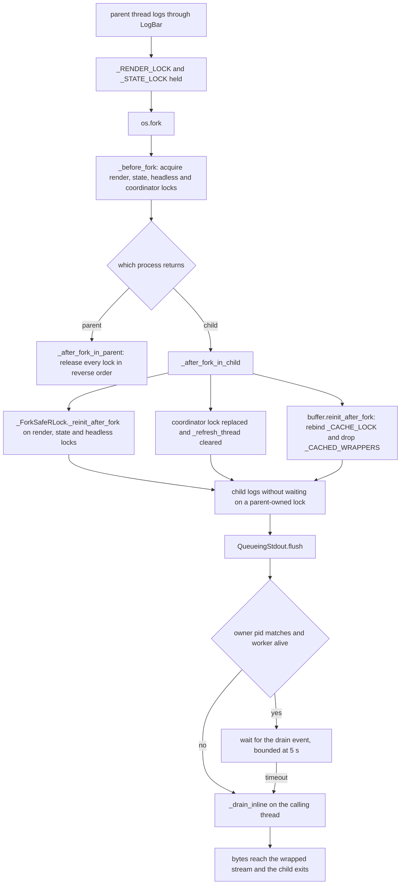

# Fork safety

LogBar's renderer is shared process-wide: one `_RENDER_LOCK`, one `_STATE_LOCK`
(`logbar/logbar.py:68-72`), one render coordinator, and a cached
`QueueingStdout` wrapper whose writes are drained by a daemon thread
(`logbar/buffer.py:312`). None of that state survives `fork()` correctly on its
own, so a child that logs can block forever.

## What broke

Two independent mechanisms, both triggered by `python -u` /
`PYTHONUNBUFFERED=1`, which makes `sys.stdout` unbuffered and therefore wrapped
in `QueueingStdout`:

1. **A dead drain thread.** `QueueingStdout.flush()`
   (`logbar/buffer.py:103`) queued a flush item and waited on its event with no
   timeout. `LogBar._print` (`logbar/logbar.py:158`) always passes
   `flush=True`, so the first log line in a child waited on a worker thread
   that only exists in the parent.
2. **Locks held across the fork.** `threading.RLock` is inherited together with
   its owner, but not the owning thread. A child that forked while another
   thread held `_RENDER_LOCK` (`logbar/logbar.py:1946` `_process`,
   `logbar/progress.py:65` `_render_locked`, the refresh worker at
   `logbar/logbar.py:1280`) could never acquire it again. A third, subtler
   variant is an import lock: `_running_in_notebook_environment`
   (`logbar/logbar.py:193`) probed `from IPython import get_ipython` on every
   call, so a child forked during that import waited on the import lock.

## What the fix does

`os.register_at_fork` (`logbar/logbar.py:129`) quiesces the renderer around the
fork, and the stdout wrapper stops trusting a worker it did not start.

`_ForkSafeRLock` (`logbar/logbar.py:33`) is a proxy with a stable identity that
swaps its inner `RLock` in the child. That matters because
`region_logger.py`, `region_progress.py` and `screen.py` bind `_RENDER_LOCK` by
value at import time; rebinding the module global would leave those references
on the dead lock.

## Before and after

| Step | Before | After |
| --- | --- | --- |
| `QueueingStdout.flush()` wait | unbounded `event.wait()` (`buffer.py:103`) | `_drain_thread_unusable()` check, then a 5 s bound, then `_drain_inline()` |
| Wrapper identity in a child | inherited, worker gone | `_owner_pid` (`buffer.py:52`) marks it foreign; cache dropped at `buffer.py:354` |
| Inherited queue and state lock | reused, so a mutex the parent worker held at fork is dead | `_ensure_live_objects()` (`buffer.py:229`) rebuilds both after a pid change |
| Renderer locks in a child | inherited held (`logbar.py:68-72`) | reinitialised at `logbar.py:111` |
| Coordinator | inherited, `_refresh_thread` points at a dead thread | lock replaced, `_refresh_thread` cleared |
| Notebook probe | imports IPython on every call | `sys.modules` gate (`logbar.py:210`) |

## Measured

Hardware: 16-core x86-64 container. Interpreters: CPython 3.14.10 (GIL) and
3.14.10t free-threaded (`sys._is_gil_enabled() is False`). Both runs use
`PYTHONUNBUFFERED=1` and a 60 s subprocess timeout per case.

| Case | Before | After |
| --- | --- | --- |
| `fork` Pool of 2 logging 4 tasks, GIL and free-threaded | hangs, killed at 60 s | exits 0, `map [0, 1, 2, 3]` |
| 100 forks while another thread logs, GIL and free-threaded | hangs, killed at 60 s | `failures 0` |
| Child `flush()` on an inherited wrapper | waits 5 s for a dead worker | 0.00 s, bytes present |
| `tests/test_fork_safety.py` on 3.14.10 | 3 failed, 2 passed | 5 passed |
| `tests/test_fork_safety.py` on 3.14.10t | 3 failed, 2 passed | 5 passed |

The `spawn` context is covered too: it inherits nothing, so it must keep
working, and it does.
