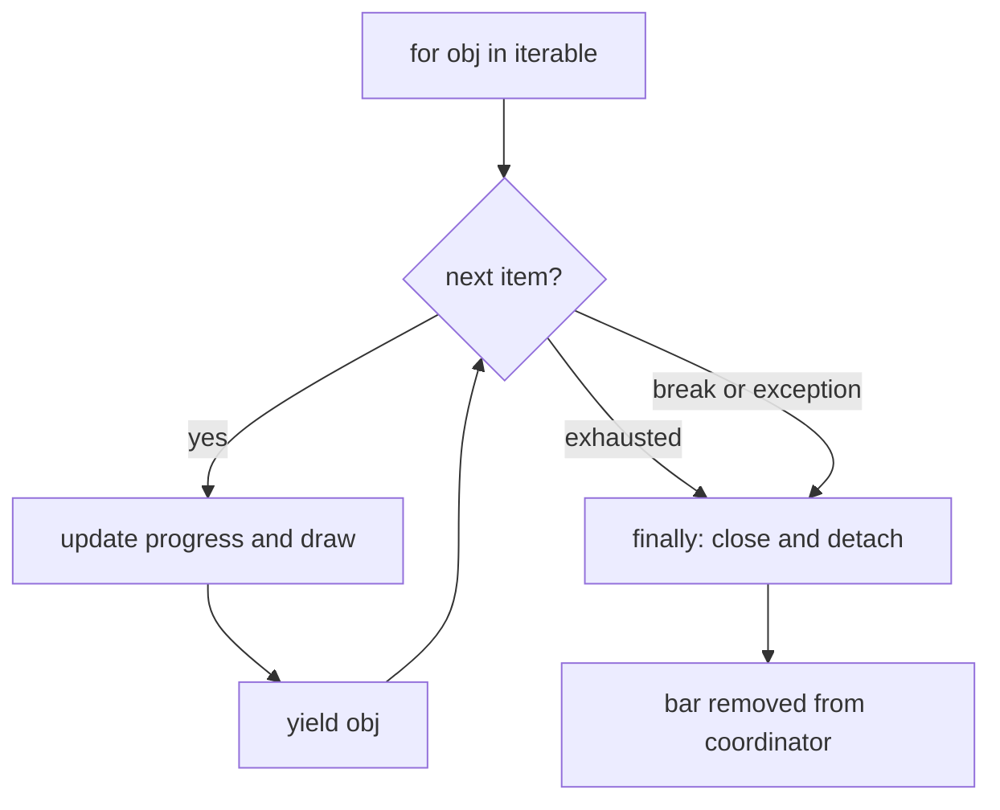
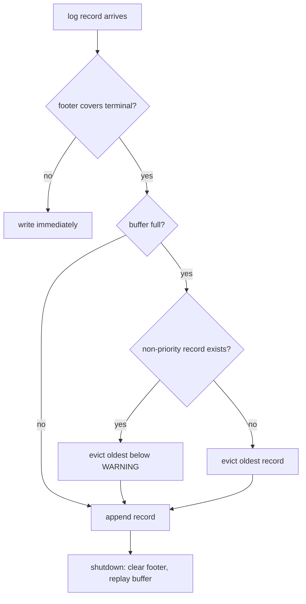

# Memory bounds and bar lifecycle

LogBar keeps live terminal state in a small set of process-wide registries.
Those registries are intentionally long-lived, so anything that is added to
them must also have a deterministic removal path. This page documents the
bounds added for issue #79.

## Progress bars detach on early exit

`ProgressBar.__iter__` used to call `close()` only after the wrapped iterable
was fully exhausted. A `break` or an exception left the bar attached, and the
coordinator's strong reference in `_attached_progress_bars` prevented
`ProgressBar.__del__` from ever running. The iteration body is now wrapped in
`try`/`finally`, so `close()` always detaches the bar:

```python
bar = log.pb(range(1000))
for item in bar:
    if item == 10:
        break
# bar is detached here, even though the iterable was not exhausted
```



`tqdm` delegates to the same generator, so it inherits the same guarantee.

## Deferred log records are bounded

When a fullscreen progress stack owns the terminal, log lines are buffered
until the footer clears. That buffer is now capped at
`_DEFERRED_LOG_LIMIT` (1000) records. When the buffer is full, the oldest
record below `WARNING` is evicted first; `WARNING`, `ERROR` and `CRITICAL`
records therefore survive normal eviction.

The buffer is also replayed during `atexit` after the footer is cleared, so a
message logged immediately before `SystemExit` is not silently dropped.



## Region scrollback is bounded

`LogRegion` stores body rows in a `collections.deque` with a configurable
maximum length. The default is `DEFAULT_REGION_SCROLLBACK` (1000) rows, which
matches the intent of the deferred-log cap:

```python
from logbar.region import LogRegion

region = LogRegion(max_scrollback=200)
```

`RegionLogBar` uses a bounded `LogRegion` by default. `body_lines` still
returns a plain `list` for compatibility, but the backing store no longer
grows forever.

## Smaller lifecycle fixes

- `ProgressBar.__iter__` now sets `self._iterating` (not the misspelled
  `self.iterating`), so the "title changed after iteration started" warnings
  actually fire.
- `.once()` deduplicates on the message value and type instead of
  `hash(msg)`. Values such as `-1` and `-2` (which share a hash) are distinct,
  and unhashable messages fall back to a stable representation instead of
  raising `TypeError`.
- `tqdm.write()` routes through the renderer when it targets `sys.stdout`, so
  an active footer is cleared and repainted instead of being overwritten.
