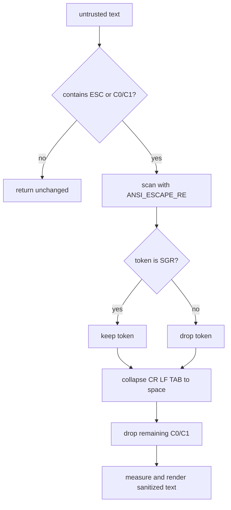

# Terminal escape-sequence safety

LogBar renders text that frequently comes from external sources: log messages,
progress titles, subtitles, and `tqdm` `desc`/`postfix` fields. Before issue
#80 those values were written to the terminal verbatim, so a payload such as
`\x1b]52;c;<base64>\x07` (OSC 52 clipboard write), `\x1b]0;title\x07`
(window title), or `\x1b[2A\x1b[2K` (cursor movement) was interpreted by the
terminal.

## What is sanitized

All untrusted text passes through `logbar.drawing.sanitize_text` before it is
measured or rendered:

- **Kept:** SGR colour sequences such as `\x1b[31m` and `\x1b[0m`, so
  legitimate coloured output still renders in colour on a TTY.
- **Removed:** OSC, DCS/SOS/PM/APC, cursor-movement CSI, and two-byte ESC
  sequences.
- **Removed:** C0/C1 control characters.
- **Collapsed:** `\r`, `\n`, and `\t` become a single space, so a value that
  looks like one row can never paint several rows and desynchronise the
  renderer's row bookkeeping.

Headless/CI output strips SGR as well, because there is no terminal to
interpret it.

```python
from logbar.drawing import sanitize_text

sanitize_text("safe \x1b]0;pwn\x07 text")
# 'safe  text'

sanitize_text("\x1b[31mRED\x1b[0m")
# '\x1b[31mRED\x1b[0m'  (colour preserved)
```

## Width measurement

`ANSI_ESCAPE_RE` now covers OSC and DCS in addition to CSI. Width helpers such
as `visible_length`, `strip_ansi`, and `truncate_ansi` therefore ignore the
payload of `\x1b]0;title\x07`, which keeps padding and redraw geometry correct.



## Where it applies

- `LogBar._emit_log_line_locked` sanitizes every log message, including
  deferred records that are replayed at shutdown.
- `ProgressBar.title` and `ProgressBar.subtitle` sanitize before caching width
  metadata, which also covers `tqdm.set_description` and `tqdm.set_postfix`.
- `RegionLogBar._emit_log_line_locked` sanitizes rows appended to a
  `LogRegion`.

`NO_COLOR`, `TERM=dumb`, headless/CI detection, and notebook rendering continue
to behave as before; sanitization only removes terminal control sequences that
LogBar did not emit itself.
