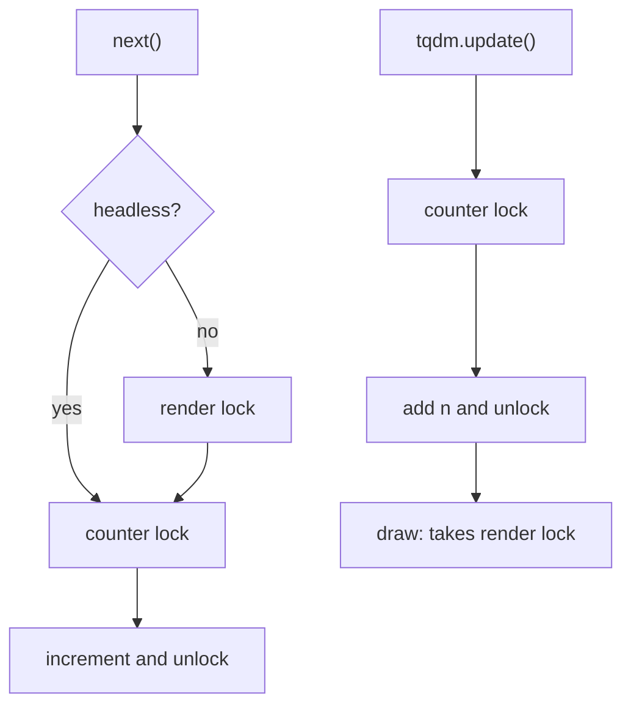

# Thread-safe progress counters

Progress bars are commonly advanced from several worker threads at once. The
rendered output is advisory, but the counter is not: a bar that reports
`80000 / 80000` after 80000 increments is a correctness guarantee.

## What was wrong

Two code paths mutated `ProgressBar.current_iter_step` without any lock:

- `ProgressBar.next()` did `self.current_iter_step += 1`. It was wrapped in
  `_render_locked`, but that decorator deliberately skips locking when the bar
  is headless, and CI auto-detection makes most non-interactive runs headless.
- `tqdm.update()` did `max(0, self.current_iter_step + n)` with no lock at all,
  in every mode.

Both are read-modify-write sequences. On a GIL build the switch can land
between the read and the store; on a free-threaded build it happens constantly.
The result is silently lost increments.

## What changed

Each bar now owns a `threading.Lock` named `_counter_lock`. It guards every
counter mutation:

- `ProgressBar.next()`
- `tqdm.update()`
- the `tqdm.n` setter

The lock is deliberately separate from the render lock, and the ordering is
strictly one-directional: **the counter lock is never held while acquiring the
render lock.** `next()` acquires the render lock (when not headless) and then
the counter lock; `update()` mutates under the counter lock, releases it, and
only then calls `draw()`. A single direction means no lock-order inversion.



Headless mode still skips the *render* lock, because there is nothing to paint.
It no longer skips counter protection.

## Verifying it yourself

The regression tests live in `tests/test_issue78_threads.py`. They run eight
threads against one bar and assert the exact expected total in headless mode,
in render mode, through `tqdm.update()`, through `next()`, and with a mix of
both. They call `sys.setswitchinterval(1e-6)` so an unguarded
read-modify-write loses updates reliably instead of only under heavy load.

```console
$ python -m pytest -q tests/test_issue78_threads.py
7 passed
```

## Scope

The lock protects the counter only. Terminal geometry, style state, and the
deferred-log buffer are unchanged by this work; the render lock still governs
painting, and `LogRegion` scrollback bounds are described in
[Memory bounds and bar lifecycle](memory-bounds.md).
